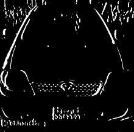
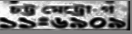

Research

# Applied inquiry, measurable systems impact

My research interests connect computer vision, wearable interaction, and systems performance. I am drawn to work that can be evaluated rigorously and translated into useful technology.

Undergraduate thesis · Computer vision

## Bengali number plate detection

Bengali-script number plates introduce distinctive character shapes and real-world variation that are not addressed well by methods designed primarily for Latin-script plates. This thesis developed and evaluated a detection and segmentation pipeline for generic images captured in natural conditions.

<ul class="tag-list"><li>Computer vision</li><li>Image processing</li><li>Sobel edges</li><li>Otsu thresholding</li><li>MLP</li></ul>

  
<strong>87%</strong>plate-detection accuracy

  
<strong>70.12%</strong>character-segmentation accuracy

  
<strong>5 stages</strong>in the localization pipeline

The system combines Sobel edge detection, Otsu thresholding, morphological closing, minimum bounding rectangles, and contour properties to localize a plate. Character recognition uses contour-based segmentation with a multi-layer perceptron model.

  

    <figure class="process-step"><figcaption>1 · Grayscale</figcaption></figure>
    <figure class="process-step"><figcaption>2 · Gaussian blur</figcaption></figure>
    <figure class="process-step"><figcaption>3 · Thresholding</figcaption></figure>
    <figure class="process-step"><figcaption>4 · Morphology</figcaption></figure>
    <figure class="process-step"><figcaption>5 · Detected plate</figcaption></figure>
  

  <a class="button-link" href="https://github.com/tajmaun/Number-Plate-Detection/tree/master/bengali_number_plate_detection">View source code</a>
  <a class="button-link button-link--ghost" href="/files/Thesis_11205028.pdf">Read thesis</a>

## Current research direction

  <article class="content-card"><h3>Wearable interaction</h3>
Reducing cognitive effort and making small-screen, context-aware interactions feel more natural.
</article>
  <article class="content-card"><h3>System performance</h3>
Finding architectural opportunities—such as parallel pre-loading—to improve constrained-device responsiveness.
</article>
  <article class="content-card"><h3>Gesture interfaces</h3>
Exploring smart-ring gesture recognition as an input method for controlling nearby devices.
</article>

